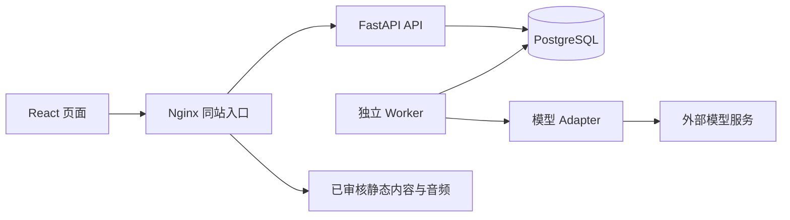

# 02 工程架构与代码组织

## 1. 技术基线

| 范围 | 首版选择 | 用途 |
|---|---|---|
| 后端 | Python 3.12、FastAPI、Pydantic、Uvicorn | 接口与输入输出约束 |
| 数据 | PostgreSQL 16、SQLAlchemy 2 风格、psycopg、Alembic | 关系存储与迁移 |
| 前端 | Node.js 22、React、TypeScript、Vite、React Router | SPA 工程与路由 |
| 前端数据 | TanStack Query、React Hook Form、Zod | 远程状态、表单与校验 |
| 图表与样式 | Recharts、CSS Modules、CSS 变量 | 趋势、统计及轻量样式 |
| 后端工具 | pytest、HTTPX、Ruff | 集成测试、HTTP、静态检查 |
| 前端工具 | Vitest、Testing Library、Playwright、ESLint | 组件和关键端到端验证 |
| 任务执行 | PostgreSQL 任务表 + 独立 Python worker | 持久化分析任务 |
| 部署 | Docker Compose + Nginx | Web/API/worker/db 同站部署 |

上述运行时为选定基线，不表示最新版本。初始化时验证库之间兼容性，提交 `uv.lock`、`package-lock.json`，前后端只能各保留一种包管理器，不能在 CI 自动升级依赖。

## 2. 目标工程目录

以下是待创建结构，目前文档交付不代表文件已存在。

```text
emotion/
├─ 项目计划.md
├─ 开发文档/
├─ backend/
│  ├─ pyproject.toml
│  ├─ uv.lock
│  ├─ alembic.ini
│  ├─ migrations/versions/
│  ├─ app/
│  │  ├─ main.py
│  │  ├─ core/           # config/security/errors/logging
│  │  ├─ db/             # session/base
│  │  ├─ api/            # deps/router + v1 各领域路由
│  │  ├─ models/         # SQLAlchemy 模型
│  │  ├─ schemas/        # 输入输出模型
│  │  ├─ repositories/   # 限定 owner 的数据库操作
│  │  ├─ services/       # auth/journals/insights/care/reviews/privacy
│  │  ├─ ai/             # provider/contracts/prompts/validation
│  │  ├─ jobs/           # runner/handlers/leases
│  │  └─ cli/            # seed/import_content/backup_cleanup
│  └─ tests/             # unit/integration/fixtures
├─ frontend/
│  ├─ package.json
│  ├─ package-lock.json
│  ├─ src/
│  │  ├─ app/            # router/providers/layout
│  │  ├─ api/            # http/client + 生成类型
│  │  ├─ components/     # 基础可访问组件
│  │  ├─ features/       # auth/journals/insights/care/reviews/settings
│  │  ├─ hooks/
│  │  ├─ styles/
│  │  └─ test/
│  └─ e2e/
├─ content/
│  ├─ activities/       # 受控活动数据及来源元数据
│  └─ support/          # 按地区维护的支持资源
├─ infra/              # Dockerfile、Compose、Nginx 配置
├─ scripts/            # 开发与校验脚本
└─ .env.example
```

## 3. 分层职责

路由：解析请求、注入用户、校验协议并转换响应；不直接拼接数据库查询或调用模型。

服务：业务规则、事务、版本校验、任务调度、模型结果验证。一个用户写操作对应一个明确事务。

仓储：执行查询与写入。所有私有资源查询都接收服务端 `user_id`，使用 `WHERE id=:id AND user_id=:current_user`；严禁先无范围取出对象再让前端判断。

AI adapter：统一 `analyze_entry`、`summarize_review`、`explain_candidates` 三类能力。业务服务不依赖某家供应商的响应结构。首版只接通一家可替换供应商，不自建模型。

Worker：领取任务、续租、执行、处理超时、验证写回。任务表不保存正文；运行时按 owner 和版本读取必要记录。

## 4. 请求链路



保存日记直接提交数据库，成功后返回；用户点击分析才创建任务。前端轮询任务状态，完成后获取分析。任务使用持久化队列，不将进程内 `BackgroundTasks` 当作可靠队列；它可用于可丢失的轻量操作。设计参考 [FastAPI Background Tasks](https://fastapi.tiangolo.com/tutorial/background-tasks/)。

## 5. Session 与浏览器安全

- 采用随机至少 256 bit 的不透明 session token；数据库只存 token 哈希。
- Cookie 名 `emotion_session`，生产 `HttpOnly; Secure; SameSite=Lax; Path=/`，不设置宽泛 Domain。
- Session 固定有效期 7 天；登录、注册成功旋转 token 和 CSRF，退出撤销数据库会话。
- `GET /auth/session` 可建立匿名会话并返回同步器 CSRF token；所有写请求包括注册、登录都校验 `X-CSRF-Token` 和允许的 Origin。
- CSRF token 绑定 session，返回体 `Cache-Control: no-store`；前端内存保存，刷新页面通过 session 接口恢复，不写 localStorage。
- 开发由 Vite 代理 `/api`，生产 Nginx 同站代理。若调整为跨站，必须重新设计 Cookie、CORS 与 CSRF，不照搬通配符配置。
- 业务不使用 OAuth2 密码流冒充第三方授权；FastAPI 安全依赖仅作为框架机制参考：[FastAPI Security](https://fastapi.tiangolo.com/tutorial/security/)。

## 6. 前端状态分工

- 服务端数据由 Query 管理，key 必须包含当前用户 ID；退出清空整个用户缓存。
- 表单状态由 React Hook Form 管理，Zod 与后端规则一致，后端仍最终校验。
- 页面临时状态用组件 state，不引入全局大仓库。
- TS 类型由后端 OpenAPI 生成，字段转换集中在 API 层；不分别手写两套协议。
- JSX 文件使用 `.tsx`，组件参数有显式类型，严格类型检查。参考 [React TypeScript 文档](https://react.dev/learn/typescript)。

## 7. 并发与日志

- 用户级写操作先短事务锁定 users 行，递增 `data_version`；模型执行期间不持数据库锁。
- 日记并发编辑校验 `version`；任务写回校验来源版本与授权版本，细节见 03/06。
- 日志记录 request_id、路由模板、状态码、耗时、内部任务 ID；不记录 Cookie、密码、正文、原始模型输入输出、导出数据和带个人信息的 URL。
- 公开错误使用稳定错误码，不透出 SQL、调用栈、密钥或供应商原始错误。
- 代码类型与变量用英文，产品界面与说明用中文；时间字段统一 `_at`，自然日期用 `_date`。
